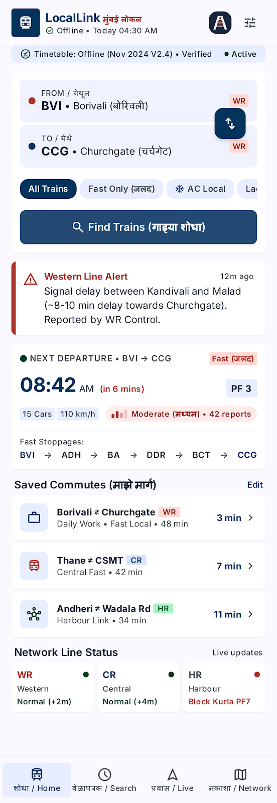
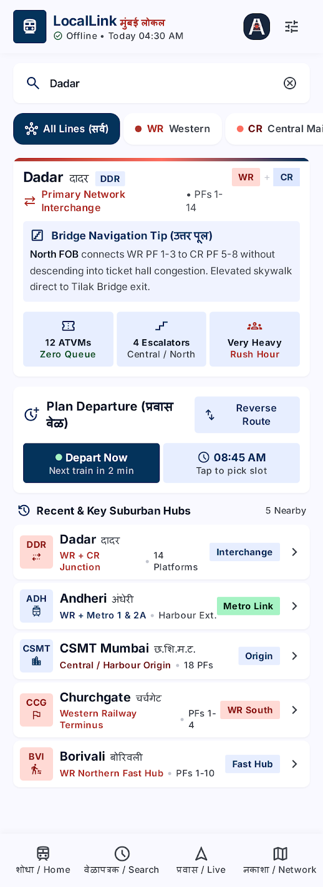
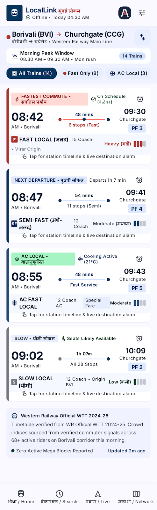
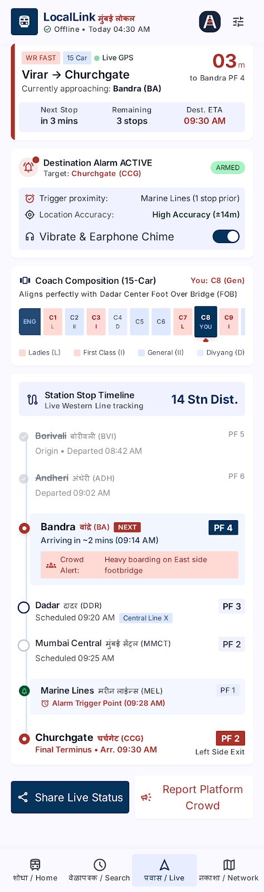
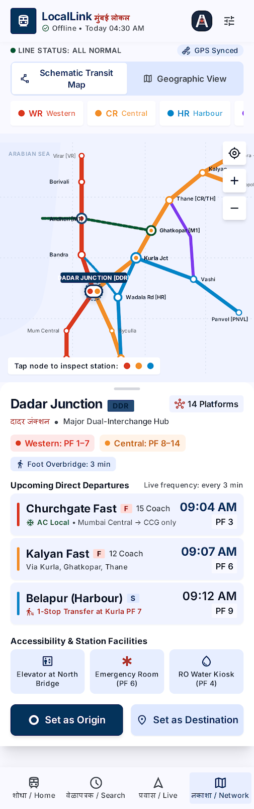
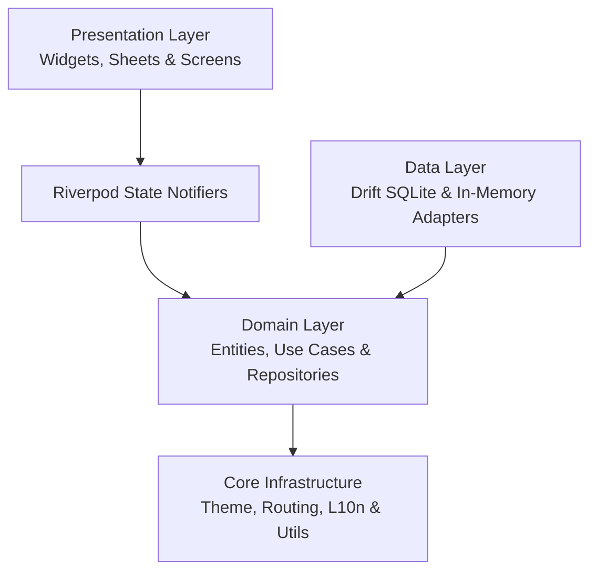

# 🚆 LocalLink — Mumbai Local Train Companion

[](https://flutter.dev)
[](https://dart.dev)
[](#-architecture-overview)
[](#-testing-strategy--quality-gates)
[](#-testing-strategy--quality-gates)
[](LICENSE)

**LocalLink** is a production-grade, offline-first Mumbai Suburban Railway companion application built with Flutter. Designed to serve over 7.5 million daily commuters navigating the busiest suburban rail network in the world, LocalLink operates with zero network dependency for timetable search and routing, while seamlessly supporting real-time crowdsourced coach crowding and station proximity alarms.

---

## 📱 App Screenshots & Visual Design System (Stitch Workspace Builder)

LocalLink's user interface is custom-engineered following the **Stitch Design System** (`stitch_project_workspace_builder`), providing an authentic, utilitarian, and high-legibility experience for Mumbai rail commuters:

<table>
  <tr>
    <td align="center" width="33%">
      <br />
      <b>1. Commuter Home & Dashboard</b><br />
      <sub>Verified offline ribbon, From/To station card with WR/CR badges, upcoming departure widget (08:42 AM PF 3), and saved commutes.</sub>
    </td>
    <td align="center" width="33%">
      <br />
      <b>2. Station Search & Interchange Hubs</b><br />
      <sub>Instant trilingual autocomplete, corridor filter tabs, Dadar Interchange Dossier with North FOB advice & 3-column amenities grid.</sub>
    </td>
    <td align="center" width="33%">
      <br />
      <b>3. Route Results & Fast/Slow Rail</b><br />
      <sub>Sticky headplate (BVI ➔ CCG), morning peak selector, fastest commute pill, 5px corridor rail, platform box & 4-tier crowd meter.</sub>
    </td>
  </tr>
  <tr>
    <td align="center" width="50%">
      <br />
      <b>4. Journey & Destination Alarm</b><br />
      <sub>Horizontal 15-Car Rake Visualizer (C1–C15 with C8 YOU active highlight), approach countdown (1.8 km to Marine Lines) & stop timeline.</sub>
    </td>
    <td align="center" width="50%">
      <br />
      <b>5. Network Map & Interchange Hubs</b><br />
      <sub>Schematic transit map & OpenStreetMap geographic switcher, line status strip, Dadar hub radar glow, and station inspector bottom sheet.</sub>
    </td>
  </tr>
</table>

---

## 🌟 Key Capabilities

### ⚡ 100% Offline-First Timetable Engine
- **Sub-50ms Query Latency**: Powered by local SQLite indexing via **Drift**, eliminating reliance on cellular reception inside crowded rakes and dense stations.
- **Fast vs. Slow & AC Local Filtering**: Clearly distinguishes between Fast, Slow, and air-conditioned services with authentic train numbers.
- **Interactive Intermediate Stop Sequences**: Sequential timeline view showing stations stopped at versus skipped stations, accompanied by authentic platform allocations.
- **Trilingual Station Autocomplete**: Instant debounced search querying across English, मराठी (Marathi), हिन्दी (Hindi), and official station codes (e.g., `CCG`, `CSMT`, `DDR`, `BVI`).

### 🧭 Intelligent Graph Transfer Engine
- **Topological Route Finding**: Built on an in-memory graph modeling the Western Line, Central Main Line, Harbour Line, and Trans-Harbour Line.
- **Multi-Corridor Interchange Hubs**: Seamlessly plans connecting journeys through major junctions (Dadar, Kurla, CSMT, Vadala Road).
- **Realistic Transfer Buffers**: Automatically enforces minimum walking and platform change buffers (default 8 minutes) to provide realistic commute plans.

### 📍 Station Proximity Geofencing Alarms
- **Battery-Efficient Geofencing**: Computes spherical great-circle distances using the Haversine formula strictly on-device without continuous battery-draining GPS tracking.
- **Configurable Distance Radii**: Choose between 500 meters, 1 kilometer, or 2 kilometers prior to arrival.
- **Loud Awakening & Notification Alerts**: Alerts commuters before their destination or interchange stop, even when the app is minimized.

### 👥 Crowdsourced Coach Density Heatmaps
- **30-Minute Freshness Decay (ADR-007)**: Community crowding reports dynamically transition through lifecycle stages:
  - 🟢 **Fresh** (0–15 min): Active high-confidence crowd reading.
  - 🟡 **Expiring** (15–30 min): Maturing report marked with amber badge.
  - ⚪ **Expired** (>30 min): Automatically excluded from queries.
- **Coach-Specific Granularity**: Report and inspect crowding by coach class (Second Class, First Class, Ladies, Divyang).
- **Graceful Offline Decoupling**: If network connectivity drops, core timetable search and routing remain completely unaffected.

### 🗺️ Interactive Suburban Railway Network Map (Zero Paid APIs)
- **OpenStreetMap Raster Integration**: Powered by `flutter_map` with OpenStreetMap raster tiles, adhering to strict zero-cost-first open-source architecture (ADR-005, `docs/API_PROVIDERS.md`).
- **Color-Coded Corridors**: Renders official line colors across Western (Red), Central (Blue), Harbour (Yellow/Amber), and Trans-Harbour (Green).
- **Interactive Station Markers & Bottom Sheets**: Tap any station or interchange hub to inspect connecting corridors, coordinates, and view live departures.

### 🤖 Trilingual Conversational Journey Assistant
- **Natural Language Journey Queries**: Ask journey questions naturally in English, मराठी (e.g. `दादर ते ठाणे गाडी कधी आहे?`), or हिन्दी (e.g. `चर्चगेट से अंधेरी ट्रेन`).
- **Dadar Junction FOB Advice**: Contextual interchange directions guiding commuters between Western Platform 1-3 and Central Platform 4-6 via foot-over-bridges.
- **Instant Quick Prompts**: Quick prompt chips for fast access to popular queries, Sunday Mega Block schedules, and AC local timetables.

### 🎨 Stitch UI Design System Alignment
- **Pixel-Accurate Stitch Integration**: Faithful implementation of design assets from Stitch Project `3963698584923642931` (stored in [`docs/screenshots/`](docs/screenshots/) and `stitch_project_workspace_builder/`):
  - [**Commuter Home & Dashboard**](docs/screenshots/01_commuter_dashboard.png): Verified offline timetable ribbon, From/To station card with WR/CR badges, upcoming departure widget (08:42 AM PF 3), and saved commute shortcuts.
  - [**Station Search & Interchange Hubs**](docs/screenshots/02_station_search.png): Instant trilingual autocomplete, corridor filter tabs, Dadar Interchange Dossier with North FOB advice & 3-column amenities grid.
  - [**Route Results**](docs/screenshots/03_route_results.png): Sticky route headplate, morning peak selector, fastest commute badge, 5px left corridor rail, platform box & 4-tier crowd meter.
  - [**Journey & Destination Alarm**](docs/screenshots/04_journey_destination_alarm.png): 15-car rake visualizer (C1-C15 with C8 YOU highlight), approach countdown (1.8 km to Marine Lines) & stop timeline.
  - [**Network Map & Hubs**](docs/screenshots/05_network_map_hubs.png): Interactive schematic transit map & OpenStreetMap geographic switcher, line status strip, Dadar hub radar glow, and station inspector bottom sheet.

### 🌐 Trilingual First-Class Citizen
- Full localization across all screens, modals, badges, and alerts in:
  - **English**
  - **मराठी (Marathi)**
  - **हिन्दी (Hindi)**
- Native Devanagari script typography with strict layout testing ensuring zero text clipping across font scaling up to 2.0x.

---

## 🏛️ Architecture Overview

LocalLink is engineered following **Clean Architecture** with inward dependency rules:



### Clean Architecture Directory Layout

```text
local-link/
├── lib/
│   ├── core/                        # Shared infrastructure & design system
│   │   ├── errors/                  # Core failures & exception mappings
│   │   ├── l10n/                    # Trilingual ARB files & generated localizations
│   │   ├── routing/                 # GoRouter 4-tab StatefulShellRoute navigation
│   │   ├── theme/                   # Material 3 Mumbai Railway color tokens & themes
│   │   └── utils/                   # DateTime formatters & platform helpers
│   ├── features/
│   │   ├── alerts/                  # Phase 7: Geofence alerts & Haversine calculator
│   │   │   ├── domain/              # StationProximityAlert entity & service interfaces
│   │   │   ├── data/                # In-memory reactive alerts repository
│   │   │   └── presentation/        # AlertsScreen, SetAlertSheet & Riverpod providers
│   │   ├── crowd/                   # Phase 6: Crowdsourced crowding reports
│   │   │   ├── domain/              # CoachCrowdReport entity & 30m decay logic
│   │   │   ├── data/                # Stream-based crowd repository
│   │   │   └── presentation/        # CoachCrowdingCard, SubmitCrowdReportSheet
│   │   ├── routing/                 # Phase 4: Graph pathfinding & transfers
│   │   │   └── domain/              # RailwayNetworkGraph & RouteGraphService
│   │   ├── search/                  # Phase 5: Search interface & station selection
│   │   │   └── presentation/        # SearchScreen, StationPickerSheet
│   │   ├── shell/                   # Phase 1: AppScaffold bottom navigation shell
│   │   └── timetable/               # Phases 2-3: Drift SQLite timetable pipeline
│   │       ├── domain/              # Station, TrainTrip, StopSchedule entities
│   │       ├── data/                # Drift AppDatabase, DAOs & TimetableParser
│   │       └── presentation/        # TimetableResultsScreen, IntermediateStopsWidget
│   └── main.dart                    # Application bootstrap & ProviderScope
├── assets/
│   └── data/
│       ├── mumbai_stations.json     # 74 authentic Mumbai stations with GPS coords
│       └── mumbai_trips.json        # Authentic weekday Fast/Slow schedules
├── test/                            # 68 automated unit, widget & integration tests
├── .github/workflows/ci.yml         # GitHub Actions automated CI verification
└── docs/                            # 11 comprehensive architectural specs (ADRs)
```

---

## 🗺️ Project Roadmap & Phase Status

| Phase | Milestone | Scope & Deliverables | Status |
| :---: | :--- | :--- | :---: |
| **0** | **Documentation Foundation** | AGENTS.md, Rules, 10 ADRs, Data Models, Security & Threat Model | **Complete** ✅ |
| **1** | **Flutter Foundation & Navigation** | M3 Theme, AppColors, 4-tab StatefulShellRoute, Riverpod L10n & Theme | **Complete** ✅ |
| **2** | **Railway Domain & Data Pipeline** | Pure Dart entities, failure hierarchy, Mumbai seed data parser & bounds check | **Complete** ✅ |
| **3** | **Drift SQLite & Offline Search** | Native SQLite schema, sub-50ms search query engine, in-memory DB tests | **Complete** ✅ |
| **4** | **Graph Router & Transfer Engine** | Corridor topological graph, interchange hubs (Dadar, Kurla), transfer routing | **Complete** ✅ |
| **5** | **Production UI & Localization** | Instant station picker sheet, timetable results, timeline stops widget, trilingual ARB | **Complete** ✅ |
| **6** | **Crowdsourced Crowding Reports** | Coach density card, 30m TTL freshness decay, crowd submission sheet | **Complete** ✅ |
| **7** | **Location & Proximity Alarms** | Haversine distance calculator, station proximity alerts, SetAlertSheet modal | **Complete** ✅ |
| **8** | **Reliability & Edge Cases** | Disjoint subgraphs, antipodal coords, second-precision decay, zero leaks | **Complete** ✅ |
| **9** | **CI/CD & Release Configuration** | GitHub Actions CI workflow, ProGuard/R8 optimization rules, build.gradle.kts | **Complete** ✅ |
| **10** | **Portfolio Polish & Readiness** | Comprehensive documentation, full test suite execution, 100% review-ready | **Complete** ✅ |

---

## 🧪 Testing Strategy & Quality Gates

Every feature in LocalLink is backed by automated tests across the test pyramid:

```text
       ▲
      / \     Widget & Flow Tests (18 tests)
     /───\    - SearchScreen & station swap flows
    /     \   - StationPickerSheet trilingual autocomplete
   /───────\  - TimetableResultsScreen & intermediate stops
  /         \ - AlertsScreen & CoachCrowdingCard interactions
 /───────────\
/  Unit & DB  \ Unit & Integration Tests (50 tests)
/─────────────\ - Drift SQLite in-memory database queries
                - Haversine distance & geofence trigger logic
                - RailwayNetworkGraph topological pathfinding
                - CoachCrowdReport freshness decay transitions
                - TimetableParser dataset validation & MMR bounds
```

### Run Quality Verification Locally

```powershell
# 1. Format check
dart format --output=none --set-exit-if-changed .

# 2. Strict static analysis (zero warnings allowed)
flutter analyze --fatal-infos

# 3. Run all 68 automated tests
flutter test
```

---

## 🚀 Getting Started

### Prerequisites
- **Flutter SDK**: `>= 3.24.0` (Stable channel)
- **Dart SDK**: `>= 3.5.0`
- **Android Studio / Android SDK**: Minimum API 24 (Android 7.0), Target API 34+
- **Git**

### Installation Steps

1. **Clone the repository**:
   ```bash
   git clone https://github.com/FahadS5534/local-link.git
   cd local-link
   ```

2. **Install Flutter dependencies**:
   ```bash
   flutter pub get
   ```

3. **Generate code (Drift SQLite & Localization)**:
   ```bash
   dart run build_runner build --delete-conflicting-outputs
   flutter gen-l10n
   ```

4. **Verify tests pass**:
   ```bash
   flutter test
   ```

5. **Run the application**:
   ```bash
   flutter run
   ```

---

## 📚 Architectural Documentation Index

| Document | Purpose |
| :--- | :--- |
| [AGENTS.md](AGENTS.md) | Mandatory protocol and operational rules for coding agents |
| [docs/ARCHITECTURE.md](docs/ARCHITECTURE.md) | System design, Clean Architecture layers & Mermaid sequence diagrams |
| [docs/DECISIONS.md](docs/DECISIONS.md) | Architecture Decision Records (ADR-001 through ADR-010) |
| [docs/PRODUCT_SPEC.md](docs/PRODUCT_SPEC.md) | Commuter personas, problem statement, scope & non-goals |
| [docs/REQUIREMENTS.md](docs/REQUIREMENTS.md) | Numbered Functional (FR) & Non-Functional (NFR) requirements |
| [docs/DATA_MODEL.md](docs/DATA_MODEL.md) | Domain entity schemas, Drift SQLite table DDL & composite indexes |
| [docs/RULES.md](docs/RULES.md) | Engineering standards, code style & null-safety rules |
| [docs/SECURITY.md](docs/SECURITY.md) | Privacy model (zero PII, device-only GPS evaluation) & threat analysis |
| [docs/TESTING.md](docs/TESTING.md) | Test pyramid, Drift native SQLite test harness & mocking strategy |
| [docs/PHASES.md](docs/PHASES.md) | 11-phase implementation roadmap with verified exit criteria |
| [docs/TROUBLESHOOTING.md](docs/TROUBLESHOOTING.md) | Verified fixes for build_runner, ARB localization, and native sqlite3 |
| [docs/RELEASE_CHECKLIST.md](docs/RELEASE_CHECKLIST.md) | Comprehensive pre-release verification checklist |
| [docs/API_PROVIDERS.md](docs/API_PROVIDERS.md) | Zero-Cost-First provider policy, endpoints, rate limits & cost accounting |
| [CHANGELOG.md](CHANGELOG.md) | Chronological version history and milestone entries |

---

## 📄 License

This project is licensed under the MIT License — see the [LICENSE](LICENSE) file for details.
