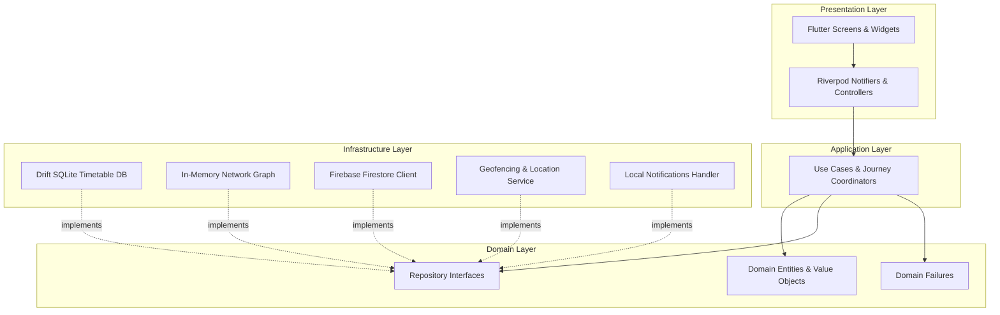
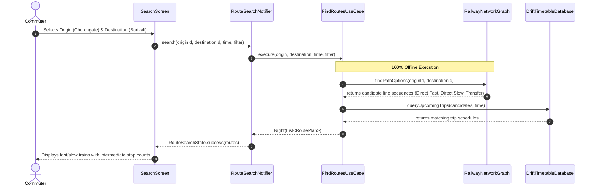
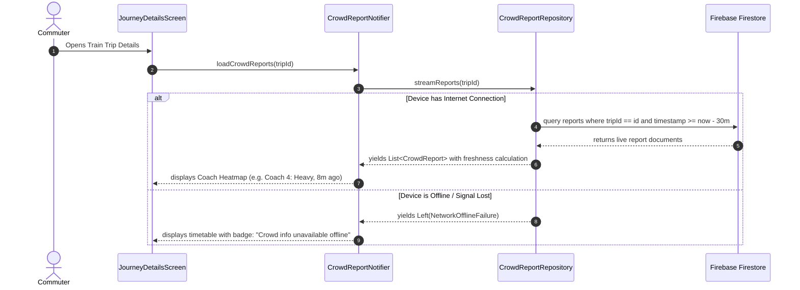
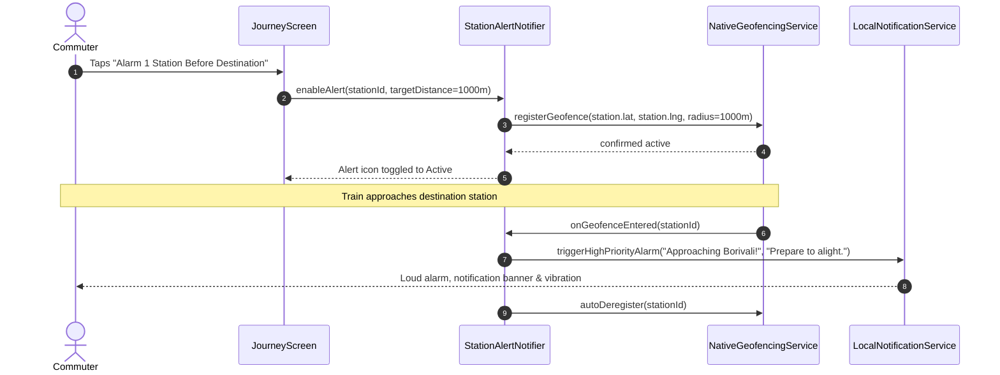

# System Architecture (docs/ARCHITECTURE.md)

This document describes the architectural foundations, layer boundaries, data flows, and subsystem integrations of **LocalLink — Mumbai Local Train Companion**.

---

## 1. High-Level Architecture Overview

LocalLink is structured around **Clean Architecture** principles and **Offline-First** design patterns. Presentation and UI widgets are completely decoupled from domain business logic and data storage mechanisms.

---

## 2. Layer Responsibilities & Module Boundaries

### 2.1 Presentation Layer (`lib/features/*/presentation/` & `lib/core/presentation/`)
- **Flutter UI**: Small, accessible, stateless/consumer widgets adhering to design tokens.
- **Riverpod Controllers**: StateNotifier / AsyncNotifier controllers managing UI state models (`Initial`, `Loading`, `Success`, `Error`).
- **Localization**: Uses `AppLocalizations.of(context)` for trilingual copy (English, Marathi, Hindi).

### 2.2 Application Layer (`lib/features/*/application/`)
- Orchestrates multi-repository workflows (e.g., querying the graph for route topology, querying Drift for next available departures, checking local alert status).
- Contains coordinators and use cases with single public `execute(...)` or `call(...)` methods.

### 2.3 Domain Layer (`lib/features/*/domain/`)
- Contains enterprise business models (`Station`, `TrainTrip`, `StopSchedule`, `RoutePlan`, `CrowdReport`).
- Pure Dart, free from any Flutter, Drift, or Firebase framework dependencies.
- Declares abstract repository contracts (e.g., `StationRepository`, `TimetableRepository`, `RoutePlannerRepository`, `CrowdReportRepository`, `AlertRepository`).
- Defines typed failures (`Failure`).

### 2.4 Infrastructure Layer (`lib/features/*/data/` & `lib/core/infrastructure/`)
- Implements the domain contracts.
- **Drift DB**: Pre-populated and updatable SQLite database containing indexed timetables, station metadata, and routes.
- **Firebase Firestore Adapter**: Reads and submits anonymized crowd reports. Isolated so network drops never crash the app.
- **Location & Geofencing Adapter**: Uses platform channels / plugins for station proximity detection.
- **Local Notifications**: Issues vibration and audible alarms when approaching destination stations.

---

## 3. Data Flows

### 3.1 Offline Journey Planning & Timetable Search Flow

### 3.2 Crowdsourced Coach Crowding Synchronization Flow

### 3.3 Station Proximity Geofencing Flow

---

## 4. Database Schema and Offline Storage

The local SQLite database (managed via Drift) consists of the following key tables:

1. **`stations`**:
   - `id` (TEXT, PK, e.g. `ST_DDR` for Dadar)
   - `code` (TEXT, e.g. `DDR`, `DR`, `BVI`)
   - `name_en`, `name_hi`, `name_mr` (TEXT, trilingual names)
   - `latitude`, `longitude` (REAL)
   - `lines` (TEXT, JSON array of lines, e.g. `["WESTERN", "CENTRAL"]`)
   - `is_interchange` (BOOLEAN)
2. **`railway_lines`**:
   - `id` (TEXT, PK, e.g. `LINE_WR`, `LINE_CR`, `LINE_HR`)
   - `name_en`, `name_hi`, `name_mr` (TEXT)
   - `color_hex` (TEXT)
3. **`trips`**:
   - `id` (TEXT, PK, e.g. `TRIP_WR_90001`)
   - `train_number` (TEXT)
   - `line_id` (TEXT, FK -> railway_lines.id)
   - `direction` (TEXT: `UP` or `DOWN`)
   - `service_type` (TEXT: `SLOW`, `FAST`, `AC_SLOW`, `AC_FAST`)
   - `source_station_id` (TEXT, FK)
   - `destination_station_id` (TEXT, FK)
   - `operating_days` (INTEGER, bitmask for Mon-Sun)
4. **`stop_schedules`**:
   - `id` (INTEGER, PK, auto-increment)
   - `trip_id` (TEXT, FK -> trips.id, INDEXED)
   - `station_id` (TEXT, FK -> stations.id, INDEXED)
   - `stop_sequence` (INTEGER)
   - `arrival_time` (INTEGER, minutes from midnight: 0 to 1439, INDEXED)
   - `departure_time` (INTEGER, minutes from midnight, INDEXED)
   - `platform` (TEXT, nullable)
5. **`metadata`**:
   - `key` (TEXT, PK)
   - `value` (TEXT)
   - (Stores timetable version, publish date, source attribution, import checksum)

---

## 5. Security & Isolation Boundaries

- **Local Storage Isolation**: SQLite DB resides exclusively inside the application's private app data sandbox on Android (`/data/data/com.locallink.mumbai/databases/`).
- **Location Coordinate Protection**: GPS coordinates never leave the device. All geofence distance checks are evaluated locally.
- **Firebase Guardrails**:
  - Unauthenticated or anonymous users can read reports within the past 30 minutes.
  - Submissions require schema validation and rate limiting.
  - No commuter PII is accepted or stored.
